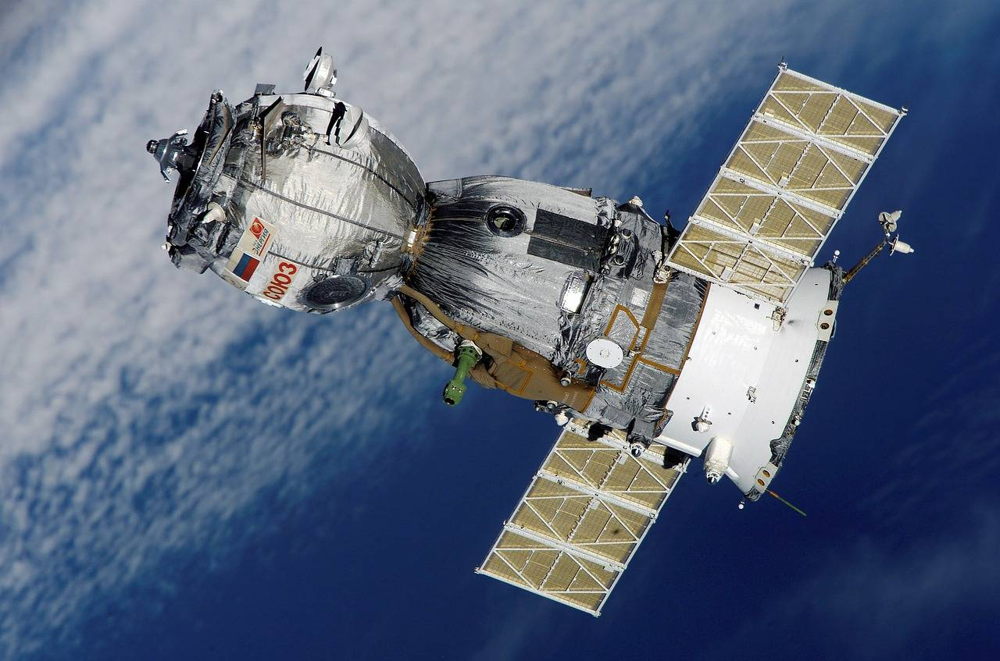

# Data sets on electricity consumption and carbon emissions in mainland China, Taiwan, Hong Kong, and Macau

[1]Monthly electricity generation in mainland China, monthly carbon emissions in mainland China, annual power demand in mainland China
[2]Monthly electricity generation in Taiwan, monthly carbon emissions in Taiwan, annual power demand in Taiwan
[3]Annual electricity generation in Hong Kong, monthly carbon emissions in Hong Kong, annual power demand in Hong Kong
[4]Annual electricity generation in Macau, monthly carbon emissions in Macau, annual power demand in Macau

## Images

<!-- PAYMENT_BLOCK -->

## Get this dataset

- Payment link (Stripe): [Buy now](https://buy.stripe.com/3cs8yP7sY87d0vu9AB)
- Payment QR code: 

<!-- /PAYMENT_BLOCK -->
